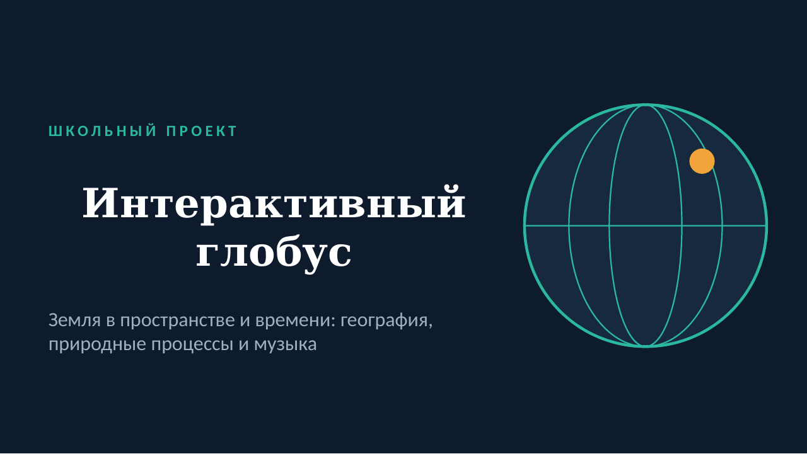
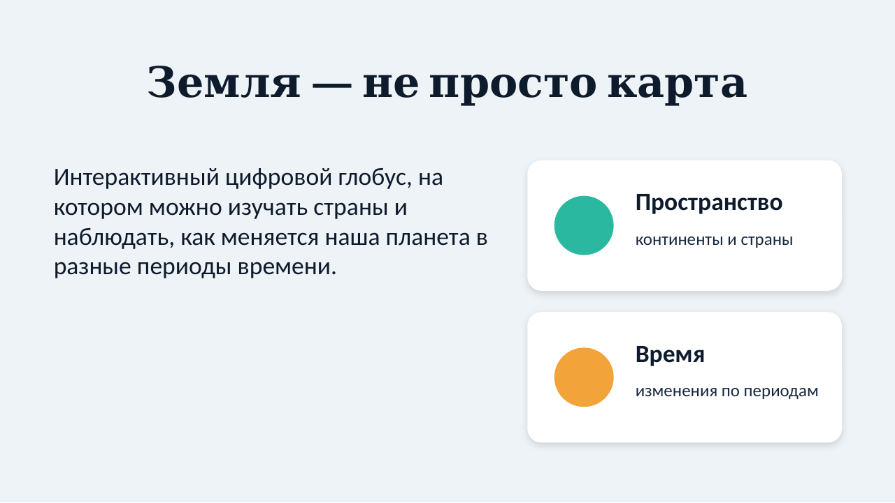
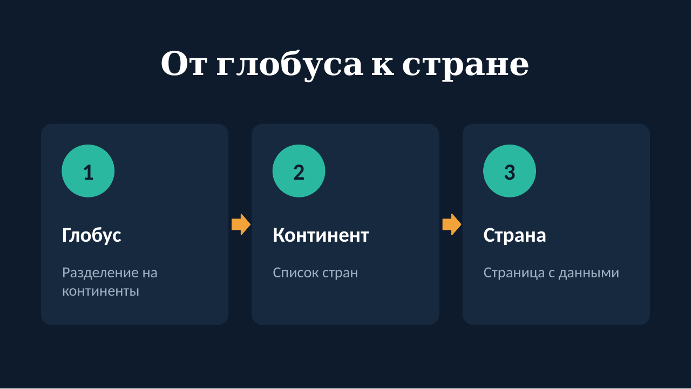
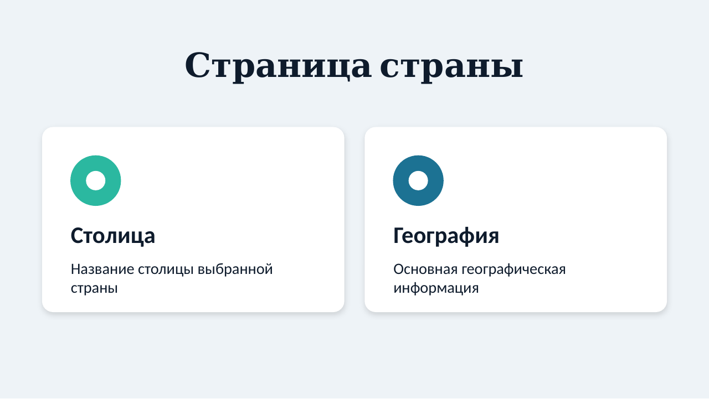
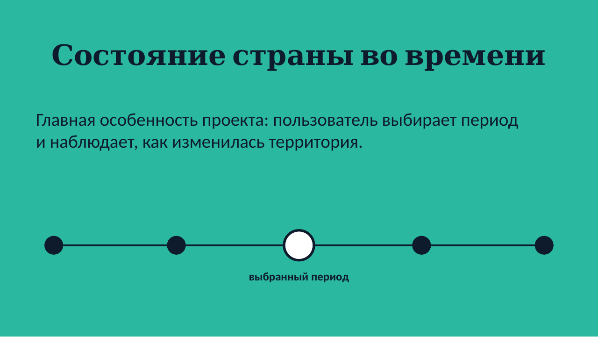
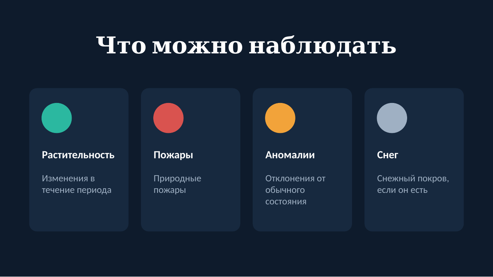
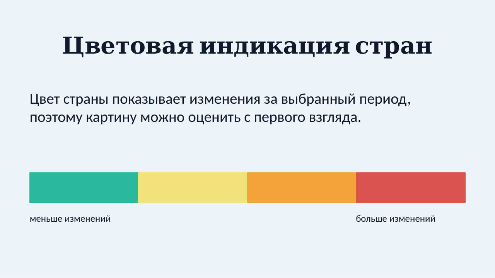
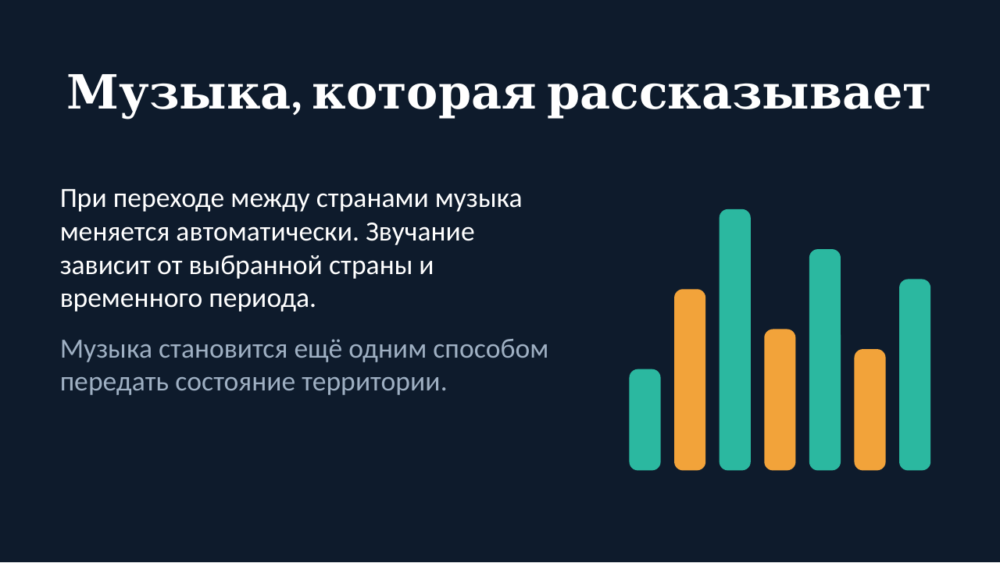
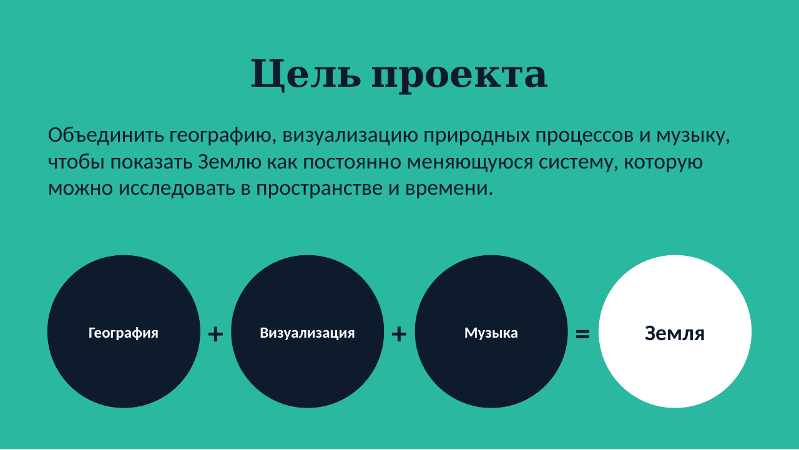
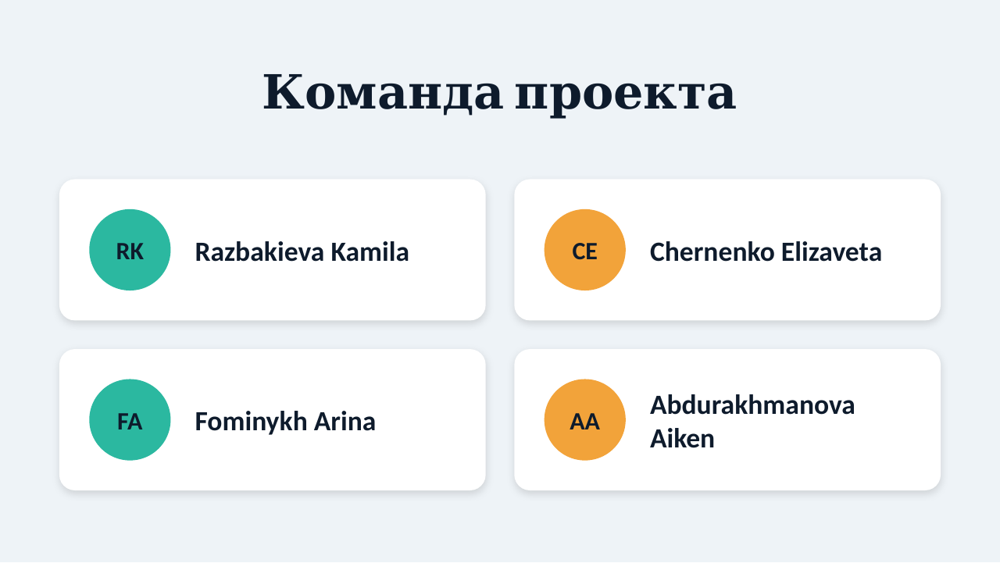

# interactive-globus

**Интерактивный глобус** — школьный проект: Земля в пространстве и времени, география, природные процессы и музыка.

Презентация целиком ниже. Её же можно открыть одним файлом: [PDF](docs/Interaktivnyi_globus.pdf) · [PowerPoint (.pptx)](docs/Interaktivnyi_globus.pptx)

